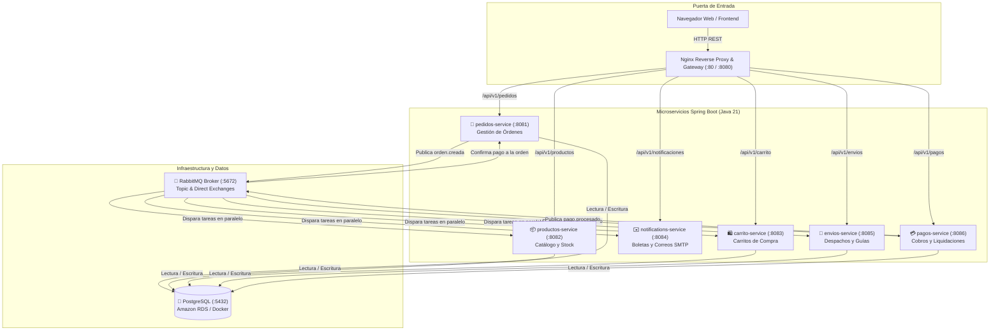
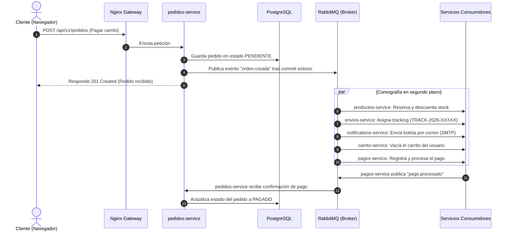

# Pedidos360 - Backend

Sistema backend de microservicios para la plataforma de comercio electrónico **Pedidos360** (Cloud Native). 

Diseñado con arquitectura orientada a eventos, comunicación asíncrona mediante mensajería y contenedores Docker para despliegue en la nube (AWS EC2 / RDS).

---

## 1. Diagrama de Arquitectura del Sistema

El siguiente diagrama muestra cómo interactúan los clientes, la puerta de enlace (Nginx), los 6 microservicios y la capa de infraestructura (Base de Datos y Broker de Eventos):



---

## 2. Diagrama de Flujo de una Compra (Coreografía de Eventos)

Cuando un cliente completa una compra, los servicios no se llaman de forma síncrona ("bloqueante") entre sí, sino que colaboran mediante **eventos asíncronos** en RabbitMQ:



---

## 3. ¿Qué hace cada microservicio?

| Microservicio | Puerto | Responsabilidad Principal |
|---|---|---|
| **`productos-service`** | `8082` | Catálogo de productos, precios, control de stock y reserva automática al comprar. |
| **`pedidos-service`** | `8081` | Registro de pedidos, máquina de estados (`PENDIENTE` $\rightarrow$ `PAGADO`) y publicación de eventos. |
| **`carrito-service`** | `8083` | Carrito persistente por usuario y vaciado automático tras la compra. |
| **`notifications-service`** | `8084` | Generación de boletas electrónicas en HTML y envío automático de correos vía SMTP (Gmail). |
| **`envios-service`** | `8085` | Logística, cálculo de despacho y generación de número de guía único (`TRACK-2026-XXXXX`). |
| **`pagos-service`** | `8086` | Registro de transacciones de pago e integración asíncrona con pedidos. |

---

## 4. Puesta en Marcha Rápida (Local o AWS)

### Paso 1: Configurar variables de entorno
Copia la plantilla de configuración:
```bash
cp .env.example .env
```
*(Si estás desplegando en AWS, puedes usar `./configure-lab.sh` para ingresar las credenciales de RDS y Cognito de forma guiada).*

### Paso 2: Levantar todos los servicios con Docker
```bash
docker compose up --build -d
```

### Paso 3: Verificar que todo esté funcionando
```bash
# Ver estado de los contenedores
docker compose ps

# Monitorear logs en vivo
docker compose logs -f
```

---

## 5. Resumen de Variables de Entorno (`.env`)

| Variable | Para qué sirve | Ejemplo |
|---|---|---|
| `SPRING_PROFILES_ACTIVE` | Modo de seguridad (`dev` para pruebas locales, `prod` para AWS con validación JWT) | `prod` |
| `DB_HOST` | Servidor de base de datos (`postgres` en local o endpoint de RDS en AWS) | `pedidos360-db.xxxx.us-east-1.rds.amazonaws.com` |
| `DB_PORT` | Puerto de PostgreSQL | `5432` |
| `DB_NAME` | Nombre de la base de datos | `pedidos360` |
| `DB_USERNAME` | Usuario de la base de datos | `postgres` |
| `DB_PASSWORD` | Contraseña de la base de datos | `<TU_PASSWORD_RDS>` |
| `RABBITMQ_USER` | Usuario para el broker RabbitMQ | `guest` |
| `RABBITMQ_PASS` | Contraseña para RabbitMQ | `<TU_PASSWORD_RABBITMQ>` |
| `MAIL_USERNAME` | Correo remitente para envío de boletas | `correo@gmail.com` |
| `MAIL_PASSWORD` | Clave de aplicación de Gmail (16 dígitos) | `<APP_PASSWORD_16_DIGITOS>` |
| `JWT_ISSUER` | Emisor de tokens Microsoft Entra ID | `https://login.microsoftonline.com/<TENANT_ID>/v2.0` |
| `JWT_AUDIENCE` | Audiencia de la API en Entra ID | `api://<CLIENT_ID>,<CLIENT_ID>` |
| `COGNITO_USER_POOL_ID` | Identificador del User Pool de AWS Cognito | `us-east-1_AbCdEf123` |
| `COGNITO_CLIENT_ID` | App Client ID de AWS Cognito | `1a2b3c4d5e6f7g8h9i0j` |
| `CORS_ALLOWED_ORIGINS` | URLs autorizadas para llamar a las APIs (frontend / CloudFront) | `https://<id>.cloudfront.net,http://<IP-EC2>` |
